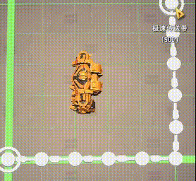

# LongerBelts

> **说明：** 本仓库是 [莳槡（shisang_makuwa）](https://github.com/makuwa8992/DSP_Mods/tree/main/LongerBelts) **LongerBelts** 的忠实移植，玩法与配置意图与原版一致；已获得原作者 **完全授权** 发布与修改。上游源码：[DSP_Mods/LongerBelts](https://github.com/makuwa8992/DSP_Mods/tree/main/LongerBelts)。

> **Note:** This is a faithful port of **shisang_makuwa**'s [LongerBelts](https://github.com/makuwa8992/DSP_Mods/tree/main/LongerBelts), published with the author's **full permission**. Settings UI uses **CatUIPanel**; patches use **CatAPI**.

## 安装

1. BepInEx（Thunderstore `xiaoye97-BepInEx-5.4.17`）
2. **CatAPI** `0.2.4`
3. **CatUIPanel** `0.0.3`
4. 本 mod **LongerBelts** `1.6.1`

## 使用

- 点右下角小猫按钮打开 **猫猫面板**，左侧切到 **Longer Belts / 加长传送带** 页。
- 选项含义与原版 IMGUI 窗口相同：经纬线模式跨度、最大间距、单位（米/格）、斜坡带路径模式、弱约束间距等。

## 与原版差异

- 设置界面改为 **CatUIPanel**（猫猫面板），不再使用独立 IMGUI 窗口。
- 依赖 **CatAPI** 安全注入 Harmony 补丁。
- 插件 GUID 仍为 `shisang_LongerBelts`，cfg 段名尽量与原版一致。

## 致谢

- 原作者：**莳槡 makuwa**（[makuwa8992/DSP_Mods](https://github.com/makuwa8992/DSP_Mods)）
